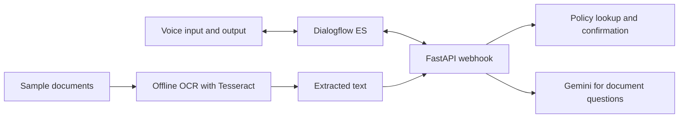

# Roadside assistance voice assistant — Dialogflow ES

A voice assistant prototype for roadside assistance. Drivers can request a tow truck, check coverage or ask about policy terms in one conversation. Policies, documents and dispatches are simulated.

## Architecture

## How it works

1. Dialogflow collects a vehicle registration and city. The FastAPI webhook validates the registration and checks the policy against sample data. If the policy is missing or does not cover roadside assistance, the flow stops before confirmation.
2. The assistant reads back the request. An explicit yes creates a simulated dispatch reference. The user can decline to cancel the request.
3. For general policy questions, the webhook sends the question and the extracted document text to Gemini. The assistant can state that the supplied documents do not cover a detail.

The webhook owns the business rules. The language model handles the separate document question flow.

## Validation

Voice checks in the Dialogflow simulator covered affirmative confirmation, cancellation, denied coverage, unknown policies and a document question with an unsupported detail. The local functional suite passed 12 of 12 checks using test doubles for the affected logic. Voice checks were sample observations in a prototype environment.

